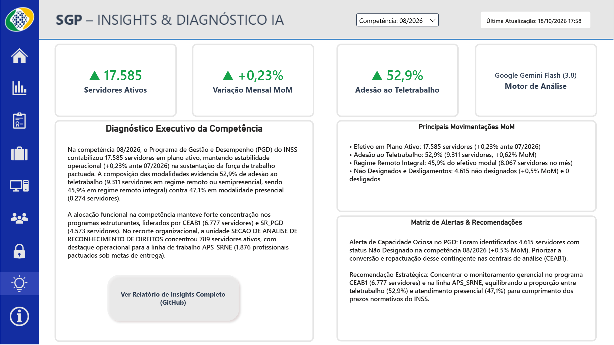
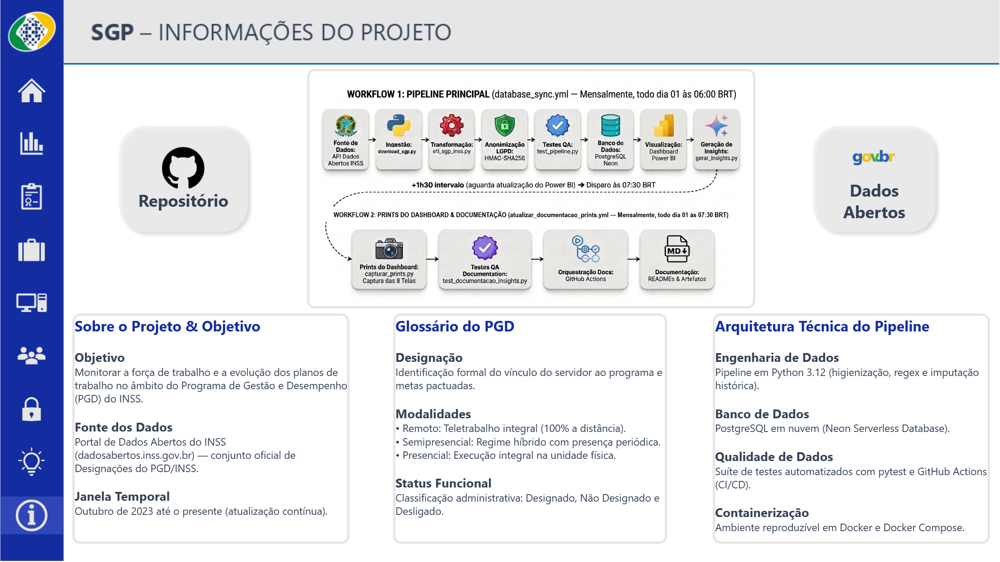

# Guia do Dashboard — Acompanhamento PGD / INSS

> **Documentação Visual e Guia de Métricas do Painel**  
> **Última Atualização:** 18/10/2026 às 18:06  
> *Capturas de tela e documentação técnica atualizadas de acordo com o modelo publicado em produção.*

Este documento apresenta a estrutura completa, os indicadores de negócio, as métricas e a documentação visual de cada página do relatório analítico do **Programa de Gestão e Desempenho (PGD)** do INSS no Power BI.

**[Acessar o Dashboard Online no Power BI (Link Público)](https://app.powerbi.com/view?r=eyJrIjoiMjNlNzBmOWQtMzVlNC00MjBhLTk0MDEtYTBhZThiZWYyNTAwIiwidCI6IjhjODgwZTJhLTM2MDAtNDVmZi1hZDM5LWJhMDRlZGM4MWYyNSJ9&pageName=bcd18bc650e27d173dae)**

---

## Estrutura de Navegação e Páginas do Painel

O dashboard foi projetado com uma barra lateral retrátil e moderna, dividindo a análise estratégica do PGD em **7 eixos temáticos**, além de páginas institucionais de apoio:

```
├── Menu Inicial (Página de boas-vindas e acesso rápido)
├── 1. Visão Geral (Evolução histórica, KPIs centrais e sazonalidade)
├── 2. Programas (Volumetria e ciclo de vida/duração média dos planos)
├── 3. Linhas de Trabalho (Atividades-fim, análise de benefícios e suporte)
├── 4. Modalidades (Remoto, Semipresencial e Presencial)
├── 5. Lotações (Distribuição por Gerências Executivas, APS e Diretorias)
├── 6. Transparência & LGPD (Auditoria de vínculos por servidor anonimizado)
├── 7. Insights & Diagnóstico IA (Diagnóstico executivo automatizado via LLM e KPIs MoM)
└── Informações do Projeto (Arquitetura, glossário e governança)
```

---

## Detalhamento das Páginas e Métricas

### Página: Menu Inicial

A tela de entrada principal do painel público, desenhada para proporcionar uma experiência de navegação limpa, moderna e intuitiva aos gestores públicos e cidadãos.


#### Componentes:
* **Cards de Acesso Rápido:** Botões interativos com direcionamento direto para cada módulo analítico do painel.
* **Barra Lateral de Navegação:** Menu corporativo com ícones de acesso e destaque da página ativa com efeito *hover*.
* **Identidade Visual SGP/INSS:** Cores alinhadas à paleta institucional em azul-marinho (`#1E3A8A`), laranja/coral (`#F97316`) e recipientes em branco puro com cantos arredondados.

---

### 1. Página: Visão Geral & Evolução Histórica

Esta página sintetiza a saúde global do programa, permitindo acompanhar a série histórica desde outubro de 2023 até o presente.


#### Indicadores e Métricas Explicados:
* **Total de Designações (KPI Card):** Volume acumulado de atos administrativos formais de pactuação de planos registrados no sistema no período filtrado.
* **Matrículas Ativas / Servidores Únicos (KPI Card):** Quantidade distinta de servidores públicos federais vinculados a planos de trabalho ativos no INSS.
* **Média de Designações / Mês (KPI Card):** Média aritmética do volume de planos mantidos simultaneamente a cada competência mensal.
* **Programas Ativos (KPI Card):** Total de programas de gestão institucionais em vigência nos órgãos de assistência, diretorias e superintendências.
* **Evolução por Status e Competência (Gráfico de Linhas):** Acompanha as 3 categorias funcionais ao longo do tempo:
  * **Designado (Verde):** Servidores com plano de trabalho vigente formalizado.
  * **Não Designado (Amarelo):** Servidores aptos sem plano pactuado registrado na competência.
  * **Desligado (Cinza):** Encerramentos de plano (destaque para a virada cadastral em lote ocorrida em março de 2025).
* **Média Histórica por Mês (Gráfico de Colunas):** Avalia a sazonalidade anual (janeiro a dezembro), evidenciando picos de renovação no encerramento do primeiro trimestre (março/abril).
* **Segmentadores de Dados:** Filtros suspensos modernos com busca por **Ano**, **Mês**, **Status** e **Programa**.

---

### 2. Página: Programas de Gestão & Duração dos Planos

Compara a densidade operacional de cada programa institucional e o tempo médio de permanência dos servidores.


#### Indicadores e Métricas Explicados:
* **Volumetria Acumulada por Programa (Gráfico de Barras Horizontal):** Quantidade total de planos vinculados a cada programa. Liderado com folga pela **CEAB1** (Central de Análise de Benefício 1), seguida por `SR_PGD`, `ATENDIMENTO` e `DIR_CENTRAL1`.
* **Média de Tempo (Dias) de Designação (Gráfico de Barras):** Calculado a partir da diferença matemática entre a data final e a data inicial do plano (`dt_fim_designacao - dt_inicio_designacao`):
  * **Perfis de Governança e Controle (`800+ dias`):** Áreas como Assessoria de Comunicação (`PG-ACS`), Corregedoria (`PG-CORREG`), Gabinete da Presidência (`PGD-GABPRE`) e Auditoria-Geral (`PG-AUDGER`), caracterizadas por planos contínuos e metas estratégicas de longo prazo.
  * **Perfis Operacionais (`< 180 dias`):** Áreas de atendimento e análise direta de requerimentos previdenciários, organizadas em ciclos curtos e metas periódicas.

---

### 3. Página: Linhas de Trabalho

Classifica a força de trabalho com base no tipo de atividade substantiva desempenhada.


#### Indicadores e Métricas Explicados:
* **Linhas de Atividade-Fim:** Medição do volume de servidores concentrados nas atividades finalísticas da autarquia:
  * Análise e concessão inicial de benefícios previdenciários e assistenciais;
  * Manutenção de direitos e gestão de pagamentos;
  * Cumprimento de decisões judiciais e recursos administrativos.
* **Linhas de Atividade-Meio:** Apoio administrativo, gestão de pessoas, logística, tecnologia e suporte operacional.
* **Evolução das Demandas:** Comparativo mensal do direcionamento da força de trabalho para redução de filas operacionais.

---

### 4. Página: Modalidades de Trabalho

Examina a distribuição da força de trabalho quanto ao regime de cumprimento da jornada de trabalho.


#### Indicadores e Métricas Explicados:
* **Proporção por Modalidade (Gráfico de Rosca / Barras):**
  * **Remoto (100% Teletrabalho):** Regime integral à distância com dispensa de controle de frequência presencial.
  * **Semipresencial (Híbrido):** Regime misto com cumprimento de parcela da jornada presencialmente na unidade e parcela remota.
  * **Presencial:** Cumprimento integral da jornada na unidade física de lotação.
* **Adesão ao Teletrabalho (%):** Percentual consolidado da soma de servidores nos regimes Remoto e Semipresencial em relação ao efetivo total pactuado.
* **Tipo de Entrega Pactuada:** Distribuição entre pactuações por **Meta e Produto** (modelo de desempenho mensurável) versus modalidades tradicionais.
* **Evolução Temporal das Modalidades:** Identificação de migração de regime de trabalho dos servidores ao longo dos ciclos anuais.

---

### 5. Página: Lotações & Distribuição Organizacional

Mapeia a descentralização territorial do PGD em toda a estrutura organizacional do INSS.


#### Indicadores e Métricas Explicados:
* **Concentração por Superintendência Regional (SR):** Divisão por macrorregiões administrativas (SR Sudeste I, SR Sudeste II, SR Sul, SR Nordeste, SR Norte/Centro-Oeste).
* **Gerências Executivas (GEX):** Identificação das unidades regionais responsáveis pela gestão operacional do quadro de servidores.
* **Agências da Previdência Social (APS):** Acompanhamento do efetivo alocado nas unidades de ponta responsáveis pelo atendimento aos segurados.
* **Normalização Cadastral:** Padronização automatizada no ETL para unificar grafias de siglas (ex: remoção de acentos e alinhamento de nomes de agências).

---

### 6. Página: Transparência & Conformidade com a LGPD

Painel dedicado à auditoria cadastral e governança de dados, garantindo máxima transparência sem expor dados pessoais dos servidores.


#### Indicadores e Métricas Explicados:
* **Tabela de Auditoria por Servidor Anonimizado (`USR-XXXXXXXX`):**
  * **Pseudonimização via HMAC-SHA256:** Matrículas originais são substituídas na origem por um hash irreversível de 8 dígitos com chave secreta, em estrito cumprimento à Lei nº 13.709/2018 (LGPD).
* **Total de Designações por Servidor:** Identifica a regularidade histórica dos servidores mais ativos. O teto histórico verificado na base é de **12 designações em 34 meses** (indicando renovações trimestrais regulares, sem super-concentração anômala).
* **Taxa de Designações / Mês:** Métrica de frequência mensal (`Total Designações / Meses Observados`). Permite auditar que taxas aparentemente elevadas em servidores recentes são causadas por amostras reduzidas (ex: 3 designações em 5 meses), evitando conclusões precipitadas de produtividade.

---

### 7. Página: SGP – Insights & Diagnóstico IA

Painel executivo integrado que disponibiliza o diagnóstico analítico gerado de forma autônoma por Inteligência Artificial (Google Gemini) diretamente na interface do Power BI. A página interpreta as oscilações mensais (MoM), adesão ao teletrabalho, concentração funcional e matriz de riscos operacionais.



#### Indicadores e Componentes Explicados:
* **Filtro de Competência:** Seletor suspenso no cabeçalho para consultar qualquer competência mensal histórica (ex: `08/2026`).
* **Timestamp de Atualização:** Indica a data e o horário exatos do processamento e geração do diagnóstico em produção.
* **Servidores Ativos (KPI Card):** Total consolidado de servidores públicos federais com plano ativo formalizado na competência (ex: `17.585`).
* **Variação Mensal MoM (KPI Card):** Taxa percentual de crescimento ou retração da força de trabalho pactuada em relação à competência imediatamente anterior (ex: `+0,23%`).
* **Adesão ao Teletrabalho (KPI Card):** Percentual da força de trabalho alocada em modalidades não estritamente presenciais (soma de teletrabalho integral e regime semipresencial, ex: `52,9%`).
* **Motor de Análise (Card Informativo):** Especificação técnica do modelo de inteligência artificial generativa utilizado na geração autônoma dos insights (ex: `Google Gemini Flash (3.8)`).
* **Diagnóstico Executivo da Competência (Card Textual Principal):** Síntese contextualizada destacando a sustentação do efetivo, proporção entre trabalho presencial e remoto, e unidades organizacionais com maior tração de análise de direitos.
* **Principais Movimentações MoM (Painel Lateral de Variações):**
  * Efetivo em plano ativo e taxa MoM;
  * Variação absoluta e relativa da adesão ao teletrabalho;
  * Regime remoto integral como regime modal da categoria remota (45,9% do efetivo total);
  * Contagem de servidores com status "Não Designado" e desligamentos do ciclo.
* **Matriz de Alertas & Recomendações (Painel Estratégico):**
  * **Alerta de Ociosidade/Repactuação:** Mapeamento de servidores não designados com potencial de repactuação imediata nas Centrais de Análise de Benefícios (CEAB1);
  * **Recomendação Estratégica:** Equilíbrio da força de trabalho entre presencial e teletrabalho para cumprimento de prazos normativos e metas acordadas.
* **Ação Direta — "Ver Relatório de Insights Completo (GitHub)":** Botão interativo com direcionamento para a documentação técnica detalhada no repositório GitHub.

---

### Página: SGP – Informações do Projeto

Reúne a governança técnica, os conceitos fundamentais do PGD e os links oficiais do ecossistema do projeto em uma grade estruturada de 4 blocos executivos:



#### Blocos e Conteúdos Explicados:
1. **Sobre o Projeto & Objetivo:**
   * **Objetivo:** Monitorar a força de trabalho e a evolução dos planos de trabalho no Programa de Gestão e Desempenho (PGD) do INSS.
   * **Fonte dos Dados:** Portal de Dados Abertos do INSS (`dadosabertos.inss.gov.br`) — conjunto oficial de Designações.
   * **Janela Temporal:** Série histórica contínua de Outubro de 2023 até o presente.
2. **Glossário & Regras de Negócio:**
   * **Designação:** Ato administrativo formal que vincula o servidor a um programa e plano de trabalho.
   * **Modalidades:** Remoto (100% teletrabalho), Semipresencial (regime híbrido com presença periódica) e Presencial (jornada integral na unidade).
   * **Status Funcional:** Designado (plano ativo), Não Designado (sem plano pactuado) e Desligado.
3. **Arquitetura Técnica do Pipeline:**
   * **Engenharia de Dados:** Pipeline em Python 3.12 (higienização, regex e imputação histórica por pontes temporais).
   * **Banco de Dados:** PostgreSQL serverless em nuvem no Neon Tech.
   * **Qualidade de Dados:** Suíte de testes automatizados com Pytest e GitHub Actions (CI/CD).
   * **Containerização:** Ambiente reproduzível em Docker e Docker Compose.
4. **Governança, Links & Repositório:**
   * **Código Aberto:** Repositório GitHub sob licença permissiva MIT.
   * **Segurança LGPD:** Pseudonimização criptográfica com hash HMAC-SHA256 irreversível.
   * **Acesso aos Dados:** Botões de ação com link direto para o repositório no GitHub e para o portal de dados abertos.

---

## Como Acessar o Dashboard Localmente (Power BI Desktop)

Você pode explorar o arquivo do projeto diretamente na sua máquina:

### Conexão Nativa com o Neon PostgreSQL (Recomendado)
O arquivo `.pbix` já está configurado com a cadeia de conexão para o banco relacional em nuvem:

1. Abra o arquivo no **Power BI Desktop**:
   ```text
   dashboard/Dash_INSS_Acompanhamento_PGD.pbix
   ```
2. O relatório se conectará à tabela `tb_pgd_inss` no Neon Tech via Direct/Import.
3. Para puxar os dados atualizados gerados pelo ETL, clique no botão **"Atualizar"** na guia *Página Inicial*.

---

## Documentos Relacionados

* [Relatório de Insights Automatizado por IA (Gemini)](insights_README.md): Documento analítico gerado de forma autônoma pelo pipeline a cada ciclo mensal, interpretando as variações dos números (versão vigente).
* [Histórico de Relatórios Mensais](relatorios/): Pasta com todas as versões mensais arquivadas (`insights_AAAA_MM.md`), mantendo o registro evolutivo do projeto vivo.
* [README Principal do Repositório](../README.md): Arquitetura completa da solução, scripts de engenharia de dados, testes automatizados e esteira de CI/CD.

