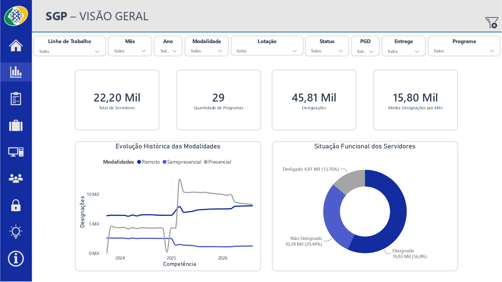
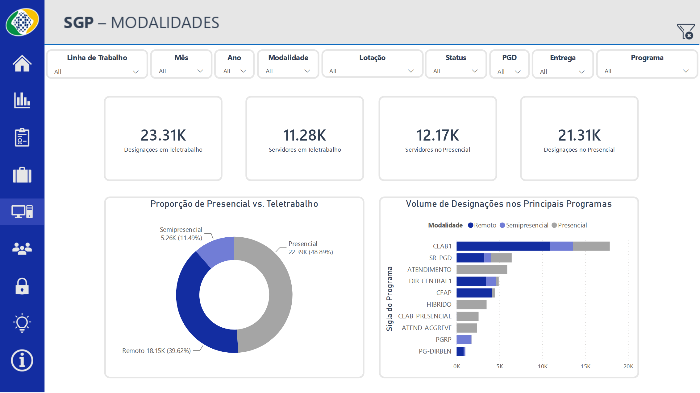
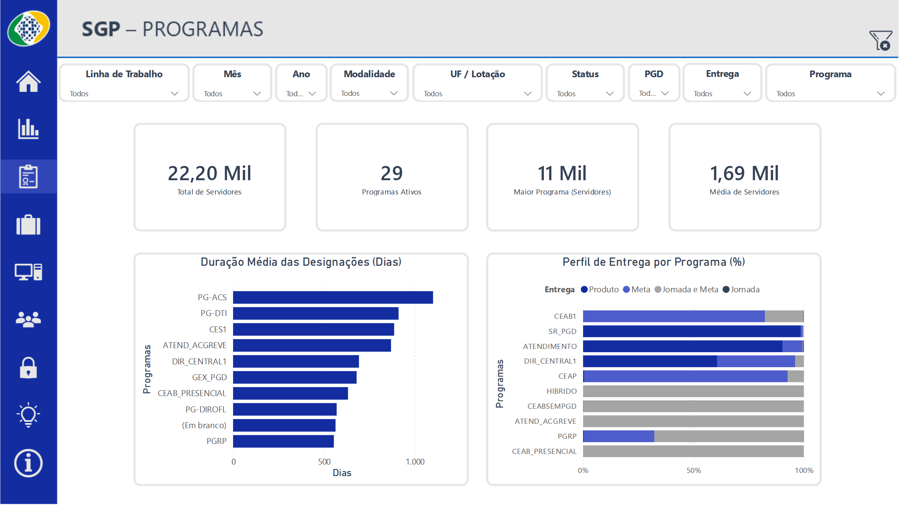
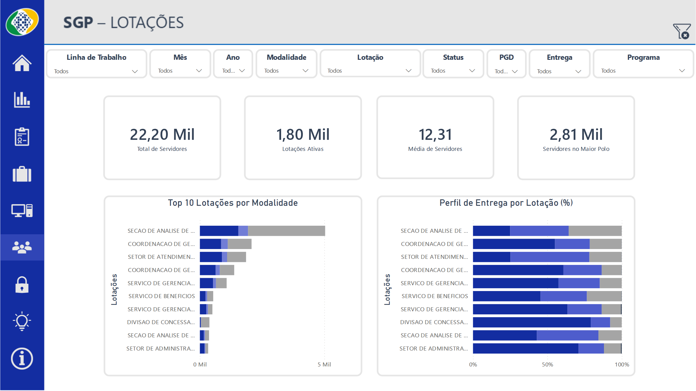
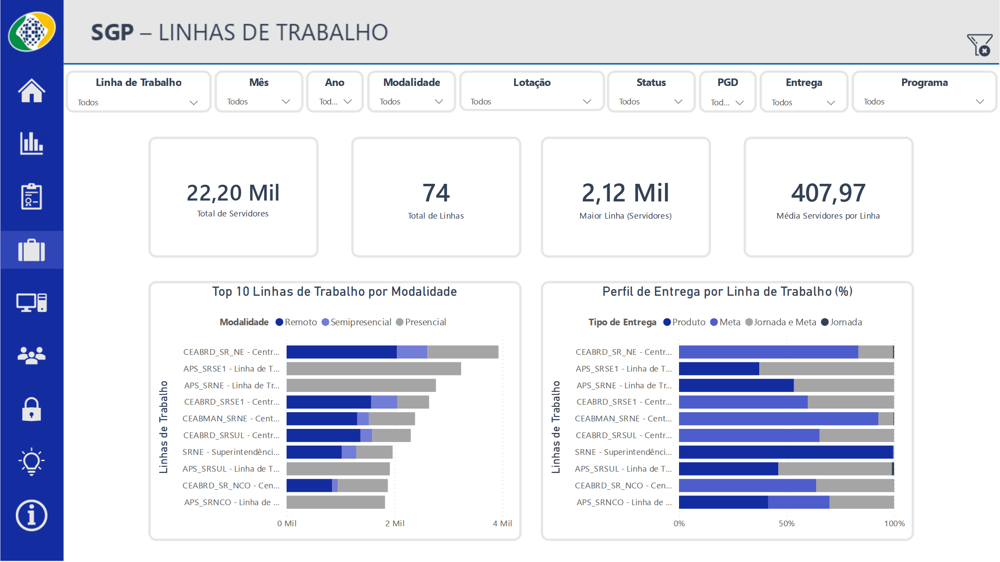
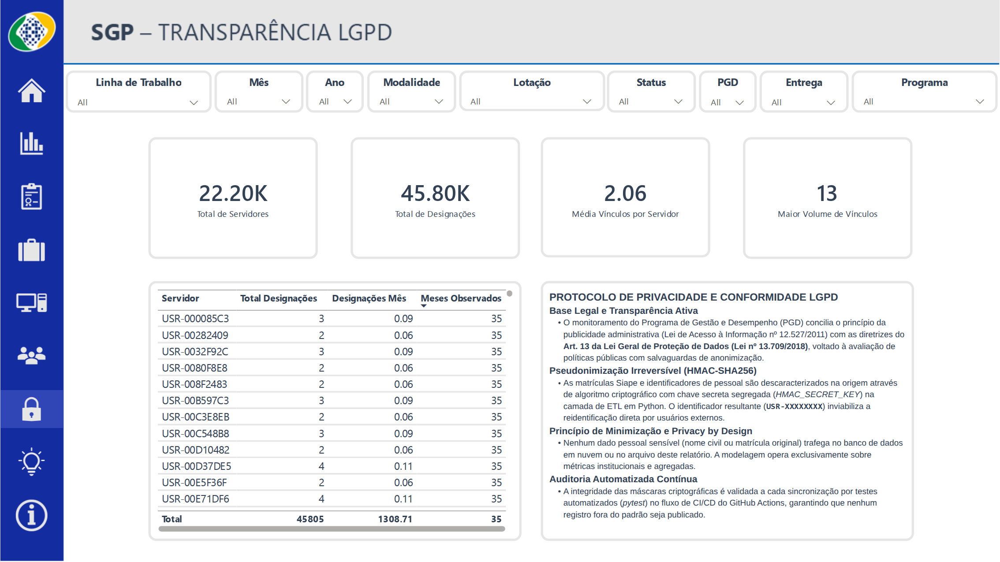

# Insights Executivos do Dashboard - Acompanhamento PGD / INSS

> **Relatório Analítico Gerado Automaticamente por Inteligência Artificial (Google Gemini - gemini-3.6-flash)**  
> **Última Atualização:** 02/11/2026 às 19:16  
> *Diagnóstico executivo sintetizado de forma autônoma a partir dos microdados oficiais tratados do PGD/INSS.*

---

> **Nota Metodológica & Governança**: Este relatório executivo sintetiza a evolução do Programa de Gestão e Desempenho (PGD) no âmbito do Instituto Nacional do Seguro Social (INSS), consolidando a série temporal de outubro de 2023 a agosto de 2026 (35 competências). A extração dos dados foi realizada diretamente a partir do repositório analítico institucional em formato Apache Parquet, garantindo elevada eficiência computacional e integridade relacional. A proteção da privacidade dos servidores observa integralmente os ditames da Lei Geral de Proteção de Dados Pessoais (Lei nº 13.709/2018 - LGPD), com a anonimização dos identificadores de pessoal realizada por meio do algoritmo de hash criptográfico HMAC-SHA256.

---

## Resumo Rápido da Série Histórica

Ao longo das 35 competências analisadas (10/2023 a 08/2026), o PGD consolidou-se como a principal ferramenta de gestão da força de trabalho e mensuração de entregas no INSS:

*   **Universo Acompanhado**: 22.200 servidores com pelo menos um registro de pactuação no período histórico.
*   **Volume de Atos de Designação**: 652.788 atos acumulados na série temporal.
*   **Média Mensal de Designações**: 18.651 atos/mês, refletindo a dinâmica contínua de repactuação e renovação dos planos de trabalho.
*   **Programas Ativos**: 26 programas de gestão cadastrados e em operação no ecossistema institucional.
*   **Densidade de Vínculos**: Média de 2,06 vínculos por servidor ao longo da série, observando um teto máximo de 12 designações acumuladas no histórico por um único servidor.

---

## Destaques da Última Competência (08/2026 vs. 07/2026)

A comparação entre a competência corrente (08/2026) e a imediatamente anterior (07/2026) indica estabilidade operacional com leve expansão na adesão ao programa:

*   **Efetivo Designado (Plano Ativo)**: Crescimento de **+0,23%**, evoluindo de 17.545 para **17.585 servidores**.
*   **Servidores Não Designados**: Incremento de **+0,50%**, passando de 4.592 para **4.615 servidores**.
*   **Desligamentos no Mês**: Redução de **-100,00%** (de 42 desligamentos em 07/2026 para 0 em 08/2026), sinalizando a manutenção integral do quadro pactuado sem descredenciamentos no período.
*   **Distribuição das Modalidades**:
    *   **Teletrabalho (Remoto + Semipresencial)**: Alcançou **9.311 servidores**, representando **52,9%** do efetivo pactuado no mês, com variação de **+0,62% MoM**.
    *   **Presencial**: **8.274 servidores**, correspondendo a **47,1%** do contingente pactuado.

---

## Análise Detalhada dos 6 Eixos do Painel

### Eixo 1: Visão Geral e Distribuição da Força de Trabalho

A análise consolidada da força de trabalho revela um elevado nível de maturidade do PGD, cobrindo a quase totalidade do quadro funcional do INSS. O volume de 17.585 servidores com planos ativos em 08/2026 demonstra a institucionalização do modelo focado em resultados. A estabilidade no volume mensal de designações (média de 18.651) corrobora a previsibilidade operacional dos ciclos de pactuação.

---

### Eixo 2: Modalidades de Trabalho (Teletrabalho vs. Presencial)

A distribuição por modalidade de execução evidencia o predomínio do trabalho descentralizado e mediado por tecnologia. Somadas, as modalidades não presenciais (Remoto e Semipresencial) sustentam 52,9% do efetivo em PGD.

| Modalidade | Designações no Mês | Proporção no Mês |
| :--- | :---: | :---: |
| **Presencial** | 8.286 | 47,1% |
| **Remoto** | 8.067 | 45,8% |
| **Semipresencial** | 1.245 | 7,1% |

*Análise de Impacto*: O modelo 100% Remoto representa 45,8% do total, alocado precipuamente em rotinas de análise intensiva de processos. Já o modelo Semipresencial (7,1%) atua como camada intermediária de transição para unidades de atendimento físico e gestão local.

---

### Eixos 3 e 4: Programas de Gestão e Duração dos Planos

A arquitetura de programas do INSS divide-se nitidamente entre iniciativas focado em análise operacional de alto volume e programas voltados à governança, tecnologia e suporte estratégico.

#### Duração Média por Programa e Perfil Executivo

| Sigla do Programa | Duração Média (Dias) | Perfil de Gestão |
| :--- | :---: | :--- |
| **PG-ACS** | **1.101 dias** | Governança / Controle / Estratégico |
| **PG-DTI** | **911 dias** | Governança / Controle / Estratégico |
| **CES1** | **887 dias** | Governança / Controle / Estratégico |
| **ATEND_ACGREVE** | **870 dias** | Governança / Controle / Estratégico |
| **DIR_CENTRAL1** | **729 dias** | Operacional / Ciclos Periódicos |
| **CEAB1** | **706 dias** | Operacional / Ciclos Periódicos |

#### Top Programas por Volume de Servidores

| Programa | Volume |
| :--- | :---: |
| **PROGRAMA DA CEAB I** | 6.777 servidores |
| **PROGRAMA DAS SUPERINTENDÊNCIAS - PGD** | 4.573 servidores |
| **PROGRAMA DAS UNIDADES DE ATENDIMENTO - PT 1800** | 3.079 servidores |
| **PROG. PRESENCIAL 6H + PONTUAÇÃO** | 1.976 servidores |
| **PROGRAMA DAS ÁREAS DA DIREÇÃO CENTRAL** | 995 servidores |

*Análise de Impacto*: Há uma correlação inversa entre o volume de servidores e a duração média do plano. Programas estratégicos e de governança (como PG-ACS com 1.101 dias e PG-DTI com 911 dias) demandam ciclos mais longos de maturação de entregas. Por outro lado, programas operacionais como a **CEAB I** (6.777 servidores) operam com ciclos médios mais curtos (706 dias), otimizados para acompanhamento contínuo da produção individual.

---

### Eixo 5: Distribuição por Lotações e Unidades Organizacionais

A alocação da força de trabalho por unidades administrativas demonstra forte concentração do PGD em coordenações de suporte sistêmico e em seções operacionais finalísticas.

| Lotação | Volume |
| :--- | :---: |
| **COORDENACAO DE GESTAO DE ORCAMENTO, FINANCAS E LOGISTICA** | 749 servidores |
| **COORDENACAO DE GESTAO DE PESSOAS** | 747 servidores |
| **SECAO DE ANALISE DE RECONHECIMENTO DE DIREITOS** | 656 servidores |
| **SECAO DE ATENDIMENTO DE DEMANDAS JUDICIAIS** | 607 servidores |
| **SERVICO DE GERENCIAMENTO DE BENEFICIOS** | 552 servidores |

*Análise de Impacto*: As Coordenações de Gestão Financeira/Logística (749) e de Pessoas (747) lideram a ocupação em termos absolutos de unidades administrativas centrais, sustentando a infraestrutura institucional. No nível tático-operacional, destacam-se a Análise de Reconhecimento de Direitos (656) e Demanda Judiciais (607), áreas críticas para a redução do passivo de processos.

---

### Eixo 6: Linhas de Trabalho e Foco Operacional

As linhas de trabalho retratam a descentralização regional do atendimento e da análise de benefícios, com protagonismo evidente das Superintendências Regionais Nordeste (SRNE) e Sudeste 1 (SRSE1).

| Linha de Trabalho | Volume |
| :--- | :---: |
| **Linha de Trabalho - Unidades de Atendimento SRNE** | 1.873 servidores |
| **Central de Análise de Benefícios de Reconhecimento de Direitos SRNE** | 1.695 servidores |
| **Superintendência Regional Nordeste** | 1.640 servidores |
| **Linha de Trabalho - Unidades de Atendimento SRSE1** | 1.390 servidores |
| **Central de Análise de Benefícios de Reconhecimento de Direitos SRSE1** | 1.173 servidores |

*Análise de Impacto*: A SRNE absorve as maiores fatias operacionais tanto na rede física (1.873 servidores nas Unidades de Atendimento) quanto na central centralizada de reconhecimento de direitos (1.695 servidores). Essa concentração reflete a demanda histórica da região e a priorização institucional no alinhamento da força de trabalho para redução do tempo médio de concessão (TMC).

---

## Auditoria de Vínculos & Conformidade LGPD

Com base nas diretrizes de governança de dados da Lei nº 13.709/2018 (LGPD), a monitoração de conformidade utiliza identificadores hash (HMAC-SHA256). A análise histórica aponta uma média institucional de 2,06 vínculos por servidor, porém identifica um grupo reduzido de servidores com elevado volume de atos acumulados ao longo dos 35 meses de observação.

| Servidor (Código LGPD) | Total Designações | Designações / Mês | Meses Observados |
| :---: | :---: | :---: | :---: |
| `USR-FFB5C436` | **12** | 0,36 | 33 |
| `USR-AAD51E3A` | **12** | 0,35 | 34 |
| `USR-79379680` | **10** | 0,29 | 35 |
| `USR-EE5D9946` | **9** | 0,28 | 32 |
| `USR-360E60E9` | **9** | 0,26 | 35 |
| `USR-DDAE3965` | **9** | 0,26 | 34 |
| `USR-A81A7AAA` | **9** | 0,28 | 32 |
| `USR-2F46A017` | **8** | 0,26 | 31 |

*Parecer de Conformidade*: Embora a taxa de renovação (Designações/Mês entre 0,26 e 0,36) indique substituição periódica de planos e não sobreposição simultânea irregular, o acúmulo de até 12 designações por servidor exige verificação contínua nos sistemas de controle para mitigar eventuais fragilidades administrativas e garantir a devida prestação de contas.

---

## Recomendações Executivas para o Próximo Ciclo

1.  **Implantar Trilha Automatizada de Auditoria sobre Múltiplos Vínculos Históricos**:
    Estabelecer alerta no sistema para servidores que atingirem limite superior a 8 atos de designação acumulados na série, com verificação automatizada de sobreposição temporal de vigências, assegurando plena conformidade com as regras institucionais e a jurisprudência dos órgãos de controle.

2.  **Repactuação Semestral do Mix Remoto/Presencial nas Centrais de Análise (SRNE e SRSE1)**:
    Considerando a alta concentração de força de trabalho nas Centrais de Análise de Benefícios da SRNE (1.695) e SRSE1 (1.173), recomenda-se avaliar a expansão calibrada da modalidade semipresencial (atualmente em apenas 7,1% no geral), promovendo ganhos de integração de equipe sem prejuízo da produtividade individual.

3.  **Padronização dos Ciclos de Vigência por Perfil de Programa (Estratégico vs. Operacional)**:
    Institucionalizar diretrizes de vigência que diferenciem formalmente os programas operacionais de alto volume (ex: CEAB I, alinhando ciclos em 360 a 700 dias) dos programas estratégicos/governança (ex: PG-ACS e PG-DTI, mantendo ciclos estendidos entre 900 e 1.100 dias), reduzindo o custo administrativo de repactuações frequentes.