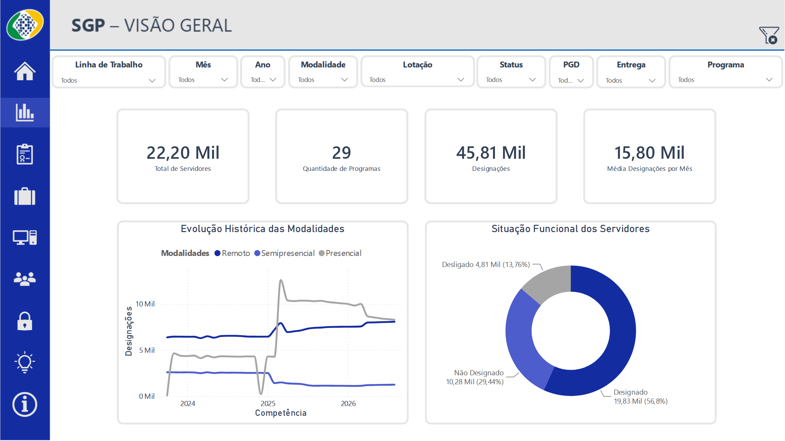
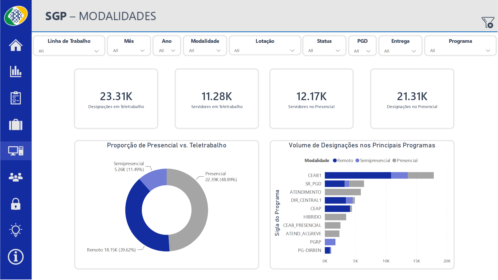
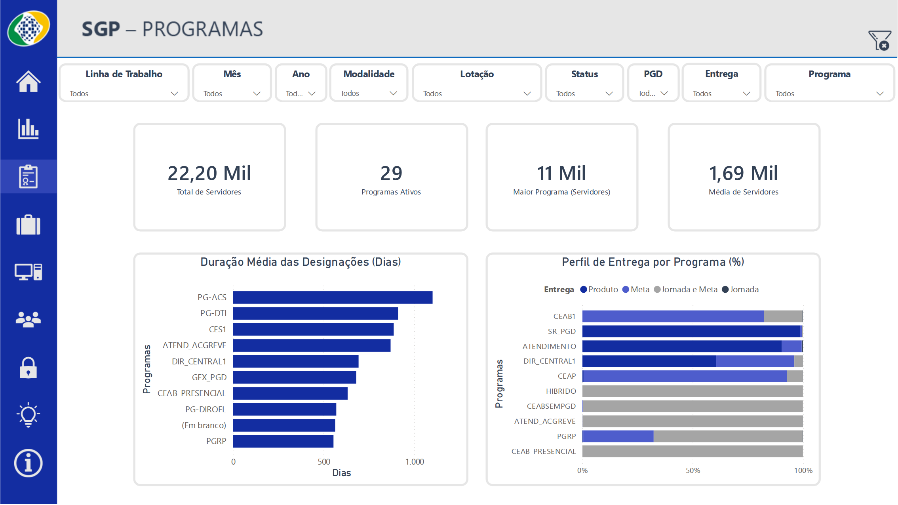
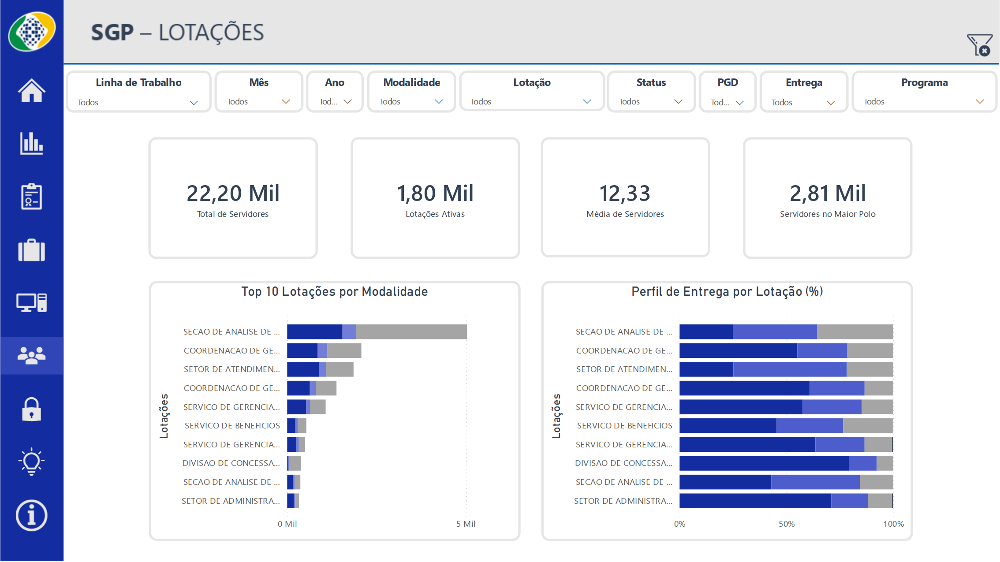
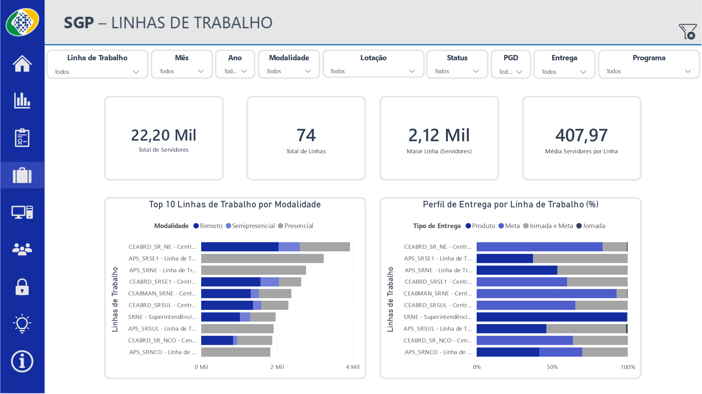
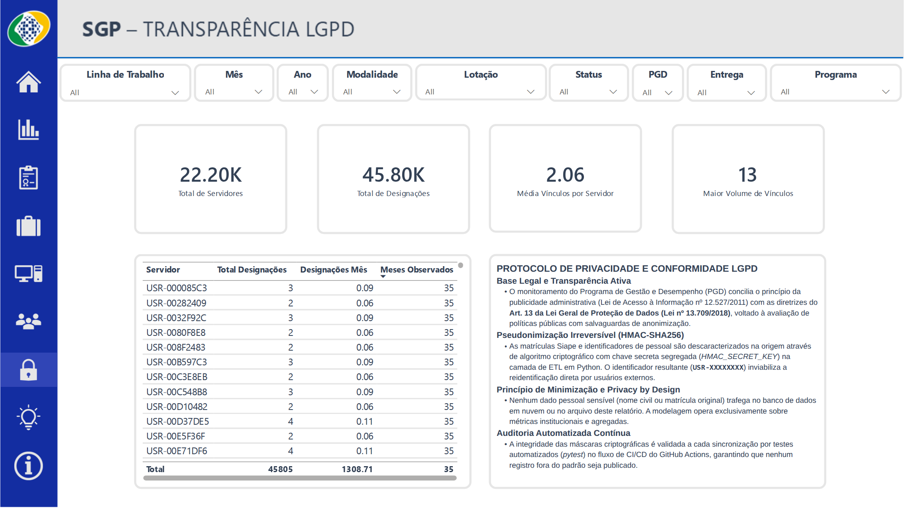

# Insights Executivos do Dashboard - Acompanhamento PGD / INSS

> **Relatório Analítico Gerado Automaticamente por Inteligência Artificial (Google Gemini - gemini-3.6-flash)**  
> **Última Atualização:** 23/11/2026 às 20:56  
> *Diagnóstico executivo sintetizado de forma autônoma a partir dos microdados oficiais tratados do PGD/INSS.*

---

> **Nota Metodológica & Governança**: Este relatório executivo sintetiza o monitoramento contínuo do Programa de Gestão e Desempenho (PGD) do INSS, estruturado a partir da extração e consolidação analítica de dados em formato de alto desempenho (*Parquet*). A série temporal abrange 35 competências contínuas, de outubro de 2023 a agosto de 2026. Em estrita observância à Lei Geral de Proteção de Dados Pessoais (Lei nº 13.709/2018 - LGPD), todas as informações relativas aos servidores foram submetidas a processos de pseudonimização via criptografia *HMAC-SHA256*, garantindo auditabilidade sem exposição de dados pessoais sensíveis.

---

## Resumo Rápido da Série Histórica

O acompanhamento acumulado ao longo dos 35 meses de monitoramento revela a consolidação do PGD como o principal modelo estruturante da força de trabalho da autarquia. A base histórica consolida os seguintes marcos operacionais:

- **Universo de Servidores Acompanhados**: 22.200 servidores registrados na série histórica.
- **Volume Acumulado de Atos de Designação**: 652.788 atos formais editados.
- **Média Mensal de Designações**: 18.651 atos/mês, demonstrando alta rotatividade administrativa e renovação contínua de planos de trabalho.
- **Diversificação de Programas**: 26 programas de gestão ativos e regulamentados.
- **Densidade de Vínculos**: Média de 2,06 vínculos por servidor ao longo da série, respeitando o limite teto operacional de 12 vínculos por indivíduo.

---

## Destaques da Última Competência (08/2026 vs. 07/2026)

O comparativo entre a última competência (08/2026) e a imediatamente anterior (07/2026) aponta estabilidade operacional com viés de expansão residual no engajamento:

- **Força de Trabalho Designada (Plano Ativo)**: Atingiu **17.585** servidores em 08/2026, ante **17.545** em 07/2026, representando uma variação positiva MoM de **+0,23%**.
- **Servidores Não Designados**: Registrou **4.615** servidores em 08/2026 versus **4.592** no mês anterior (+0,50%), mantendo a margem de contingente fora de pactuação temporária dentro dos padrões normativos.
- **Desligamentos do Programa**: Redução total na movimentação de saída, passando de 42 servidores desligados em 07/2026 para **0** desligamentos em 08/2026 (variação de **-100,00%**).
- **Avanço do Teletrabalho**: A força pactuada em regime não presencial (Remoto + Semipresencial) somou **9.311** servidores (52,9% do total pactuado), apresentando variação MoM de **+0,62%**.
- **Regime Presencial**: Contabilizou **8.274** servidores pactuados (47,1% do total de designados).

---

## Análise Detalhada dos 6 Eixos do Painel

### Eixo 1: Visão Geral e Estrutura Macro do Programa

A análise macroscópica ratifica que a grande maioria da força de trabalho acompanhada (79,2%) encontra-se ativamente vinculada a planos de trabalho do PGD, enquanto 20,8% (4.615 servidores) permanecem sem designação ativa no mês de agosto de 2026. A ausência de desligamentos formais no mês de referência aponta para um período de manutenção e continuidade dos pactos vigentes, sem descontinuidades administrativas abruptas.

---

### Eixo 2: Distribuição por Modalidades de Trabalho

A distribuição das designações ativas por modalidade operacional revela a preponderância das atividades executadas fora das dependências físicas tradicionais, embora o trabalho presencial mantenha fatia expressiva na composição institucional.

| Modalidade | Designações no Mês | Proporção no Mês |
| :--- | :---: | :---: |
| **Presencial** | 8.286 | 47.1% |
| **Remoto** | 8.067 | 45.8% |
| **Semipresencial** | 1.245 | 7.1% |

O arranjo Remoto (45,8%) somado ao Semipresencial (7,1%) consolida a modalidade de Teletrabalho como maioria absoluta (52,9%). O baixo percentual de adesão ao modelo Semipresencial aponta para uma escolha institucional por polos mais definidos (integralmente presencial ou integralmente remoto).

---

### Eixos 3 e 4: Programas de Gestão e Ciclo de Duração Média

A análise dos 26 programas ativos evidencia uma clara dicotomia entre planos focados em governança/controle de longo prazo e planos operacionais vinculados a ciclos periódicos de análise de processos.

#### Duração Média por Programa

| Sigla do Programa | Duração Média (Dias) | Perfil de Gestão |
| :--- | :---: | :--- |
| **PG-ACS** | **1101 dias** | Governança / Controle / Estratégico |
| **PG-DTI** | **911 dias** | Governança / Controle / Estratégico |
| **CES1** | **887 dias** | Governança / Controle / Estratégico |
| **ATEND_ACGREVE** | **870 dias** | Governança / Controle / Estratégico |
| **DIR_CENTRAL1** | **729 dias** | Operacional / Ciclos Periódicos |
| **CEAB1** | **706 dias** | Operacional / Ciclos Periódicos |

#### Concentração de Servidores nos Principais Programas

| Programa | Volume |
| :--- | :---: |
| **PROGRAMA DA CEAB I** | 6,777 servidores |
| **PROGRAMA DAS SUPERINTENDÊNCIAS - PGD** | 4,573 servidores |
| **PROGRAMA DAS UNIDADES DE ATENDIMENTO - PT 1800** | 3,079 servidores |
| **PROG. PRESENCIAL 6H + PONTUAÇÃO** | 1,976 servidores |
| **PROGRAMA DAS ÁREAS DA DIREÇÃO CENTRAL** | 995 servidores |

O **PROGRAMA DA CEAB I** absorve a maior fatia da força de trabalho (6.777 servidores), alinhando-se à estratégia central da autarquia de mitigar o passivo de processos de reconhecimento de direitos.

---

### Eixo 5: Alocação Por Lotações e Unidades Administrativas

A alocação de pessoal pactuado reflete a dupla exigência do INSS: suporte corporativo estratégico e capacidade operacional na análise de demandas judiciais e concessão de benefícios.

| Lotação | Volume |
| :--- | :---: |
| **COORDENACAO DE GESTAO DE ORCAMENTO, FINANCAS E LOGISTICA** | 749 servidores |
| **COORDENACAO DE GESTAO DE PESSOAS** | 747 servidores |
| **SECAO DE ANALISE DE RECONHECIMENTO DE DIREITOS** | 656 servidores |
| **SECAO DE ATENDIMENTO DE DEMANDAS JUDICIAIS** | 607 servidores |
| **SERVICO DE GERENCIAMENTO DE BENEFICIOS** | 552 servidores |

Unidades sistêmicas centrais, como a Coordenação de Gestão de Orçamento, Finanças e Logística (749) e a Coordenação de Gestão de Pessoas (747), sustentam elevados contingentes pactuados, garantindo a retaguarda administrativa para as seções operacionais finalísticas.

---

### Eixo 6: Dinâmica e Volume nas Linhas de Trabalho

A distribuição da força produtiva por linhas de trabalho destaca o protagonismo regional das Centrais de Análise de Benefícios e Unidades de Atendimento, com ênfase na Região Nordeste (SRNE) e Sudeste 1 (SRSE1).

| Linha de Trabalho | Volume |
| :--- | :---: |
| **Linha de Trabalho - Unidades de Atendimento SRNE** | 1,873 servidores |
| **Central de Análise de Benefícios de Reconhecimento de Direitos SRNE** | 1,695 servidores |
| **Superintendência Regional Nordeste** | 1,640 servidores |
| **Linha de Trabalho - Unidades de Atendimento SRSE1** | 1,390 servidores |
| **Central de Análise de Benefícios de Reconhecimento de Direitos SRSE1** | 1,173 servidores |

A Superintendência Regional Nordeste concentra as maiores linhas de trabalho do país em termos absolutos, totalizando mais de 5.200 servidores engajados diretamente em suas linhas operacionais.

---

## Auditoria de Vínculos & Conformidade LGPD

A análise de integridade cadastral e conformidade normativa monitora a densidade de pactuações por servidor, visando mitigar sobrecargas de trabalho ou inconsistências de multiplano. A média do órgão situa-se em **2,06 vínculos por servidor**, bem abaixo do limite regulamentar teto de 12 designações.

| Servidor (Código LGPD) | Total Designações | Designações / Mês | Meses Observados |
| :---: | :---: | :---: | :---: |
| `USR-FFB5C436` | **12** | 0.36 | 33 |
| `USR-AAD51E3A` | **12** | 0.35 | 34 |
| `USR-79379680` | **10** | 0.29 | 35 |
| `USR-EE5D9946` | **9** | 0.28 | 32 |
| `USR-360E60E9` | **9** | 0.26 | 35 |
| `USR-DDAE3965` | **9** | 0.26 | 34 |
| `USR-A81A7AAA` | **9** | 0.28 | 32 |
| `USR-2F46A017` | **8** | 0.26 | 31 |

Os registros apontam que apenas dois servidores (`USR-FFB5C436` e `USR-AAD51E3A`) atingiram o teto normativo de 12 designações ao longo de 33 e 34 meses observados, mantendo uma média ponderada de ~0,35 designações por mês. Essa taxa é compatível com a renovação regular de planos curtos ou repactuações de metas.

---

## Recomendações Executivas para o Próximo Ciclo

1. **Revisão e Padronização do Modelo Semipresencial**: Tendo em vista que apenas 7,1% das designações adotam o formato Semipresencial, recomenda-se à Diretoria de Gestão de Pessoas avaliar os critérios de adesão a esta modalidade, identificando se há barreiras operacionais ou se a preferência pelo modelo integralmente remoto (45,8%) atende satisfatoriamente às demandas das Unidades de Atendimento.
2. **Harmonização Prazos dos Programas Estratégicos vs. Operacionais**: Recomenda-se calibrar a duração dos planos de trabalho dos programas de governança (ex: PG-ACS com 1.101 dias e PG-DTI com 911 dias) com revisões intermediárias obrigatórias a cada 180 dias, alinhando a vigência de longo prazo ao acompanhamento dinâmico de entregas praticado na CEAB (706 dias).
3. **Monitoramento Cautelar do Teto de Vínculos**: Instituir alertas automáticos no sistema de gestão para servidores que atingirem 10 ou mais vínculos acumulados na série (como `USR-79379680`, `USR-FFB5C436` e `USR-AAD51E3A`), prevenindo eventuais duplicidades de metas ou inconsistências na apuração da força de trabalho alocada.