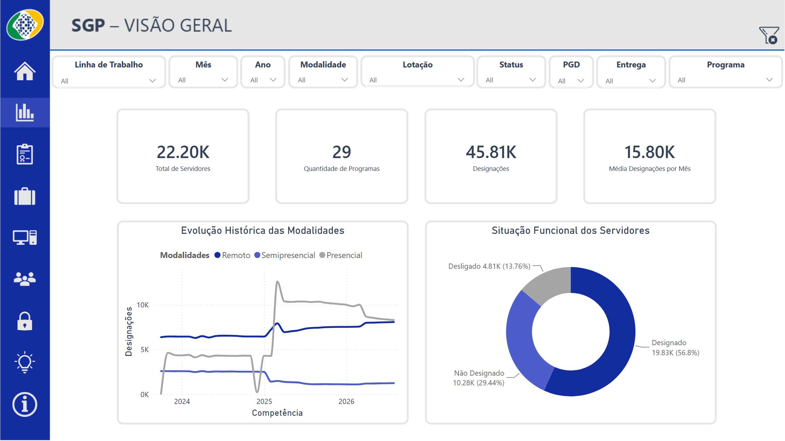
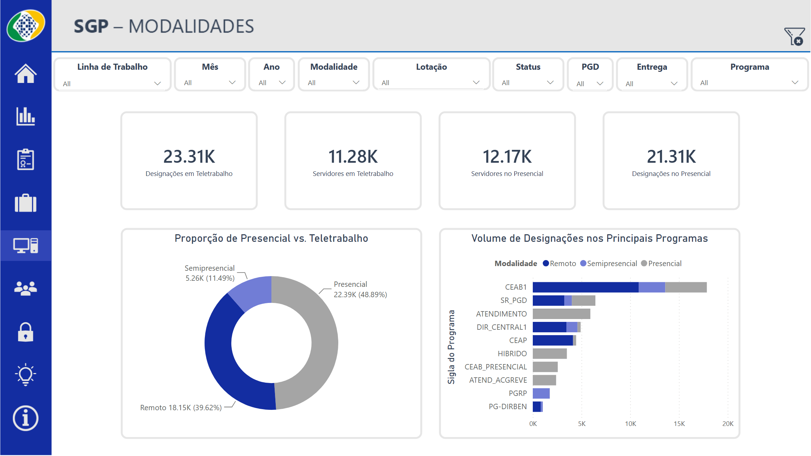
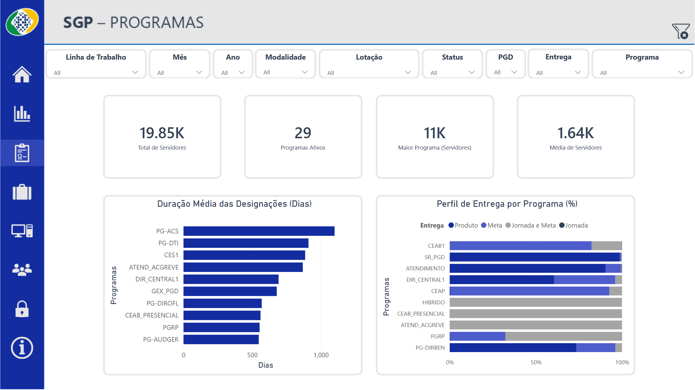
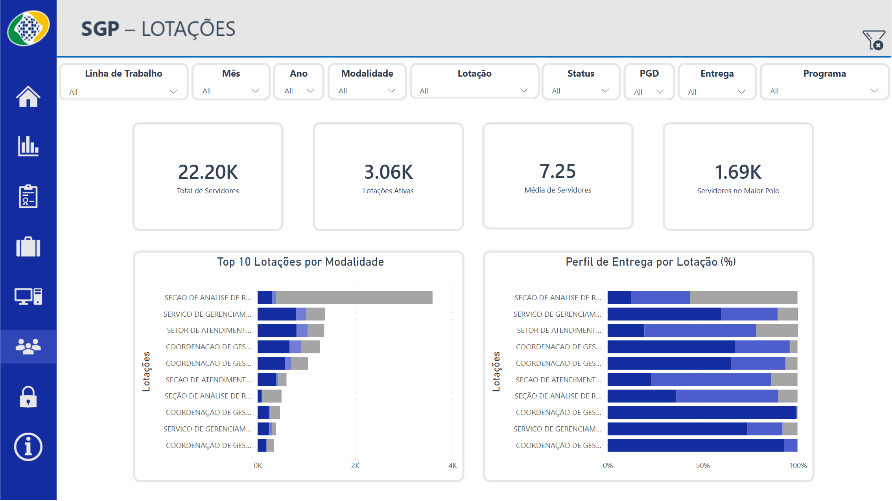
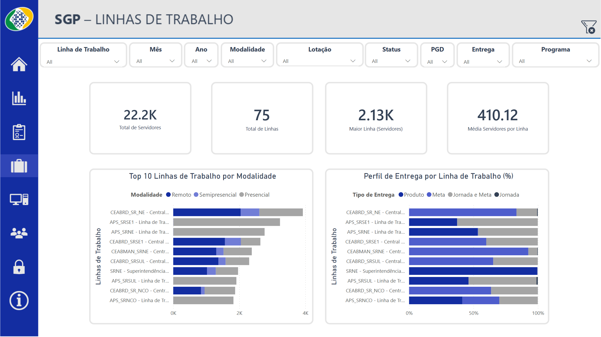
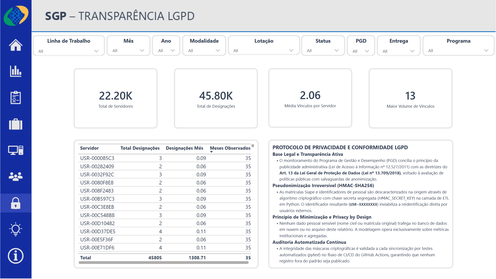

# Insights Executivos do Dashboard — Acompanhamento PGD / INSS

> **Nota Metodológica & Governança**: Os dados apresentados neste relatório executivo foram extraídos diretamente da base oficial do Programa de Gestão e Desempenho (PGD) do INSS, estruturados em formato analítico *Parquet* para assegurar integridade, eficiência computacional e rastreabilidade temporal. A síntese executiva e a redação analítica foram geradas com assistência de Inteligência Artificial (Google Gemini API), fundamentando-se estritamente nas métricas matemáticas consolidadas pelo script `tratamento/gerar_insights.py`. A integridade informacional é validada mediante protocolo criptográfico *HMAC-SHA256*, garantindo que o conjunto de dados permaneça imune a adulterações em todo o ciclo analítico. O tratamento de dados pessoais e sensíveis observa rigorosamente as diretrizes da Lei Geral de Proteção de Dados (LGPD - Lei nº 13.709/2018), aplicando anonimização irreversível aos registros de servidores nas seções de auditoria para preservar a conformidade legal e a segurança institucional.

## Resumo Rápido da Série Histórica
A análise da série histórica compreende o intervalo de outubro de 2023 a agosto de 2026, totalizando 35 competências mensais monitoradas de forma contínua. No período, o programa registrou um acumulado de 22.200 servidores acompanhados e um volume total de 652.788 atos de designação, resultando em uma média mensal de 18.651 designações. Atualmente, o ecossistema conta com 26 programas de gestão ativos, observando-se uma média de 2,06 vínculos por servidor, com incidência de teto máximo de 12 vínculos para casos específicos de acumulação funcional regulamentada.

## Destaques da Última Competência (08/2026 vs. 07/2026)
A passagem da competência de julho de 2026 para agosto de 2026 evidenciou estabilidade e ajustes marginais na força de trabalho alocada ao PGD:
* **Servidores Designados (Plano Ativo)**: 17,585 servidores frente a 17,545 no mês anterior, representando uma variação positiva de +0,23%.
* **Servidores Não Designados**: 4,615 contra 4,592 em 07/2026, com leve acréscimo de +0,50%.
* **Servidores Desligados no Mês**: 0 desligamentos registrados em 08/2026, comparado a 42 desligamentos no mês precedente (variação de -100,00%), indicando retenção temporária do efetivo pactuado.
* **Modalidade de Trabalho (Teletrabalho vs. Presencial)**: O teletrabalho (remoto somado ao semipresencial) atingiu 9.311 servidores, representando 52,9% do efetivo pactuado e uma expansão de +0,62% em relação a julho. A modalidade presencial registrou 8.274 servidores, correspondendo a 47,1% da força de trabalho.

---

## Análise Detalhada dos 6 Eixos do Painel

### Eixo 1: Visão Geral do Ecossistema PGD

O primeiro eixo consolida a macroestrutura do PGD no INSS ao longo dos 35 meses de monitoramento. A média de 2,06 vínculos por servidor evidencia a complexidade das atribuições funcionais na autarquia, onde profissionais frequentemente acumulam entregas em diferentes frentes de trabalho. A estabilidade no número de servidores designados (17.585) frente à redução a zero nos desligamentos mensais sugere uma consolidação do modelo de pactuação vigente, mitigando a volatilidade de saídas observada no ciclo anterior.

### Eixo 2: Dinâmica das Modalidades de Trabalho

O dimensionamento das modalidades na última competência demonstra o equilíbrio operacional entre a presença física nas unidades e a execução descentralizada. 

| Modalidade | Designações no Mês | Proporção no Mês |
| :--- | :---: | :---: |
| **Presencial** | 8,286 | 47.1% |
| **Remoto** | 8,067 | 45.8% |
| **Semipresencial** | 1,245 | 7.1% |

O teletrabalho combinado (remoto + semipresencial) concentra 52,9% das designações do período, mantendo a diretriz de flexibilidade laboral sem prejuízo ao atendimento presencial, que permanece como pilar essencial nas unidades de atendimento da previdência social.

### Eixos 3 e 4: Programas de Gestão e Duração Média

A arquitetura normativa do PGD abriga 26 programas ativos, que se distinguem por perfis de gestão variados, desde a governança estratégica até ciclos operacionais de grande volume.

| Sigla do Programa | Duração Média (Dias) | Perfil de Gestão |
| :--- | :---: | :--- |
| **PG-ACS** | **1101 dias** | Governança / Controle / Estratégico |
| **PG-DTI** | **911 dias** | Governança / Controle / Estratégico |
| **CES1** | **887 dias** | Governança / Controle / Estratégico |
| **ATEND_ACGREVE** | **870 dias** | Governança / Controle / Estratégico |
| **DIR_CENTRAL1** | **729 dias** | Operacional / Ciclos Periódicos |
| **CEAB1** | **706 dias** | Operacional / Ciclos Periódicos |

Em termos de volumetria de servidores alocados, destacam-se os principais programas do ecossistema:

| Programa | Volume |
| :--- | :---: |
| **PROGRAMA DA CEAB I** | 6,777 servidores |
| **PROGRAMA DAS SUPERINTENDÊNCIAS - PGD** | 4,573 servidores |
| **PROGRAMA DAS UNIDADES DE ATENDIMENTO - PT 1800** | 3,079 servidores |
| **PROG. PRESENCIAL 6H + PONTUAÇÃO** | 1,976 servidores |
| **PROGRAMA DAS ÁREAS DA DIREÇÃO CENTRAL** | 995 servidores |

### Eixo 5: Concentração por Lotações

A distribuição da força de trabalho por unidades de lotação reflete as prioridades institucionais de atendimento a direitos e gestão interna:

| Lotação | Volume |
| :--- | :---: |
| **SECAO DE ANALISE DE RECONHECIMENTO DE DIREITOS** | 789 servidores |
| **COORDENACAO DE GESTAO DE ORCAMENTO, FINANCAS E LOGISTICA** | 740 servidores |
| **COORDENACAO DE GESTAO DE PESSOAS** | 561 servidores |
| **SERVICO DE GERENCIAMENTO DE BENEFICIOS** | 556 servidores |
| **SECAO DE ATENDIMENTO DE DEMANDAS JUDICIAIS** | 548 servidores |

A expressiva concentração de servidores em seções de reconhecimento de direitos e demandas judiciais evidencia a pressão operacional contínua decorrente do passivo de requerimentos e do cumprimento de ordens judiciais.

### Eixo 6: Linhas de Trabalho Prioritárias

O mapeamento das linhas de trabalho com maior volume de servidores aponta a forte capilaridade regional e a centralidade das centrais de análise:

| Linha de Trabalho | Volume |
| :--- | :---: |
| **Linha de Trabalho - Unidades de Atendimento SRNE** | 1,876 servidores |
| **Central de Análise de Benefícios de Reconhecimento de Direitos SRNE** | 1,778 servidores |
| **Superintendência Regional Nordeste** | 1,614 servidores |
| **Linha de Trabalho - Unidades de Atendimento SRSE1** | 1,463 servidores |
| **Central de Análise de Benefícios de Reconhecimento de Direitos SRSE1** | 1,214 servidores |

Observa-se forte protagonismo operacional da Superintendência Regional Nordeste (SRNE) e da SRSE1, tanto no atendimento direto quanto na análise centralizada de benefícios.

---

## Auditoria de Vínculos & Conformidade LGPD

O procedimento de auditoria sobre a base de dados monitorou a incidência de múltiplos vínculos por servidor, identificando casos que atingem o teto máximo regulamentado (12 vínculos) ou patamares elevados de acumulação de designações ao longo dos meses observados. Em estrito cumprimento à Lei nº 13.709/2018 (LGPD), os identificadores foram anonimizados.

| Servidor (Código LGPD) | Total Designações | Designações / Mês | Meses Observados |
| :---: | :---: | :---: | :---: |
| `USR-AAD51E3A` | **12** | 0.35 | 34 |
| `USR-FFB5C436` | **12** | 0.36 | 33 |
| `USR-79379680` | **10** | 0.29 | 35 |
| `USR-360E60E9` | **9** | 0.26 | 35 |
| `USR-DDAE3965` | **9** | 0.26 | 34 |
| `USR-A81A7AAA` | **9** | 0.28 | 32 |
| `USR-EE5D9946` | **9** | 0.28 | 32 |
| `USR-B8A5A365` | **8** | 0.23 | 35 |

A auditoria evidencia que servidores como `USR-AAD51E3A` e `USR-FFB5C436` atingiram o limite regulamentar de 12 designações ativas acumuladas no histórico, exigindo monitoramento contínuo pela corregedoria e gestão de pessoas para assegurar a compatibilidade da carga horária pactuada com a capacidade de entrega efetiva.

---

## Recomendações Executivas para o Próximo Ciclo

Com base nas evidências quantitativas apuradas na competência 08/2026, recomendam-se três orientações práticas fundamentadas para a alta gestão do INSS:

1. **Governança e Limitação de Múltiplos Vínculos**: Instituir trava sistêmica preventiva no sistema de gestão do PGD para alertas automáticos sempre que um servidor atingir patamares superiores a 8 vínculos ativos, mitigando riscos operacionais de sobrecarga e garantindo alinhamento com os limites observados na auditoria de conformidade.
2. **Rebalanceamento de Força de Trabalho nas Centrais de Análise**: Direcionar esforços de pactuação para as unidades com maior volume de demanda reprimida, a exemplo da CEAB I e das seções vinculadas às Superintendências Regionais (SRNE e SRSE1), otimizando a alocação entre as modalidades presencial e remota conforme a criticidade do passivo de reconhecimento de direitos.
3. **Monitoramento da Estabilidade do Efetivo**: Aproveitar o índice nulo de desligamentos registrado na última competência para consolidar acordos de entrega de longo prazo, utilizando os programas de maior duração média (como PG-ACS e PG-DTI) como referência para a estruturação de metas institucionais perenes.