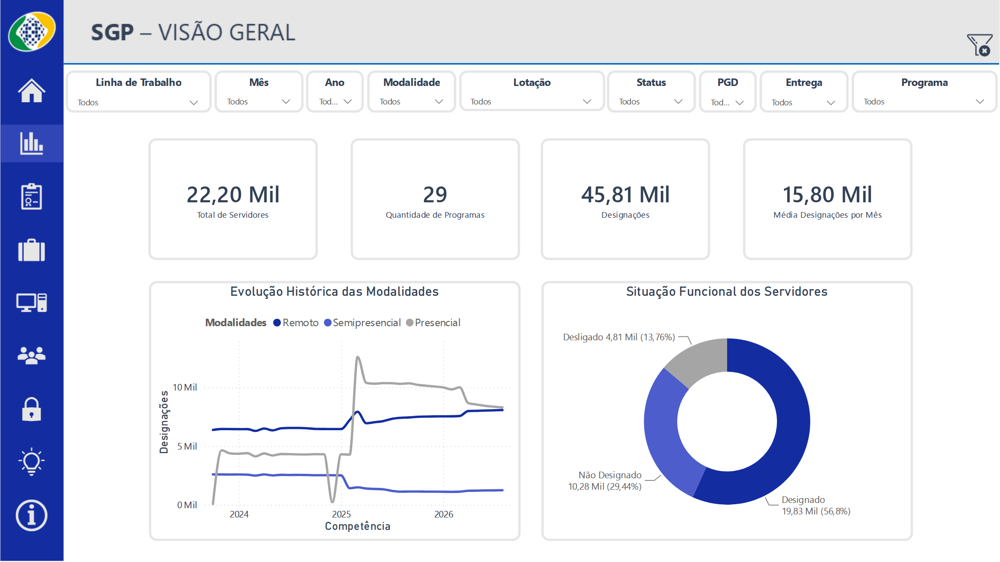
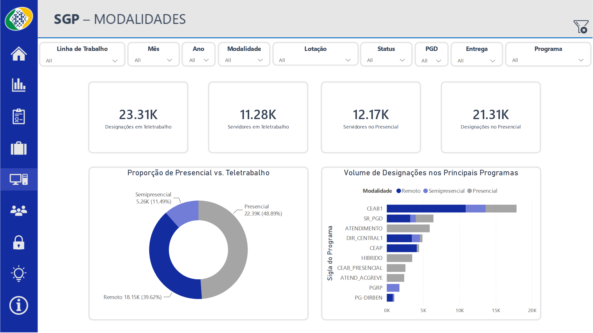
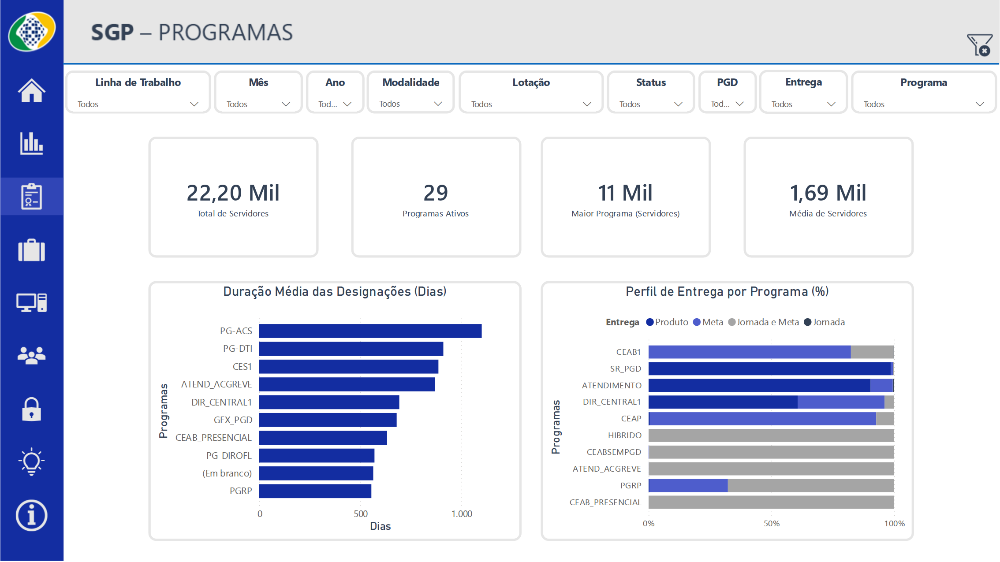
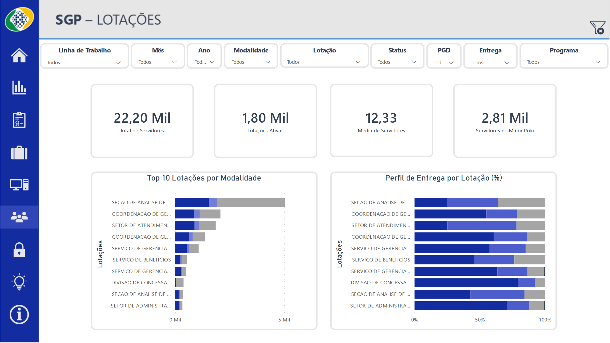
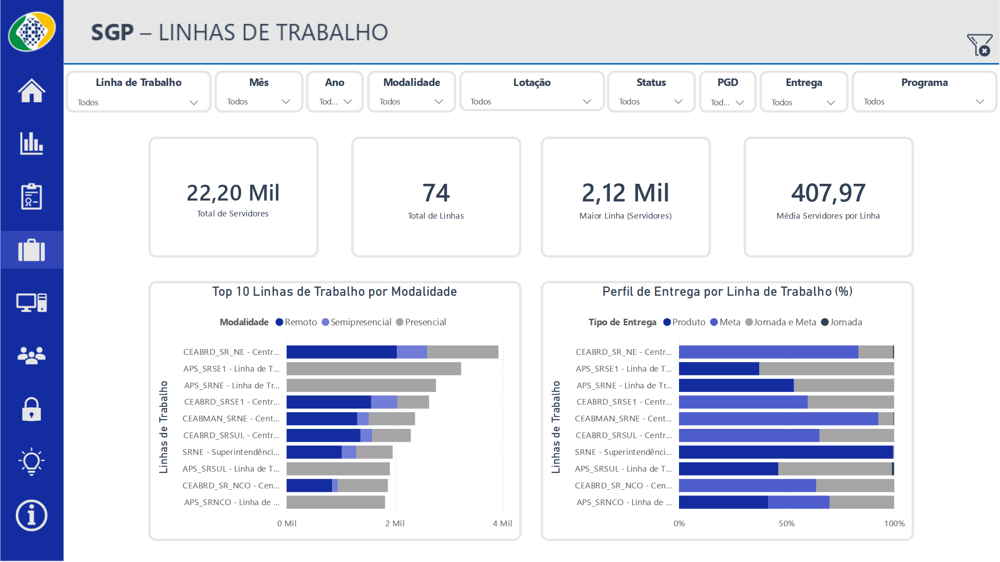
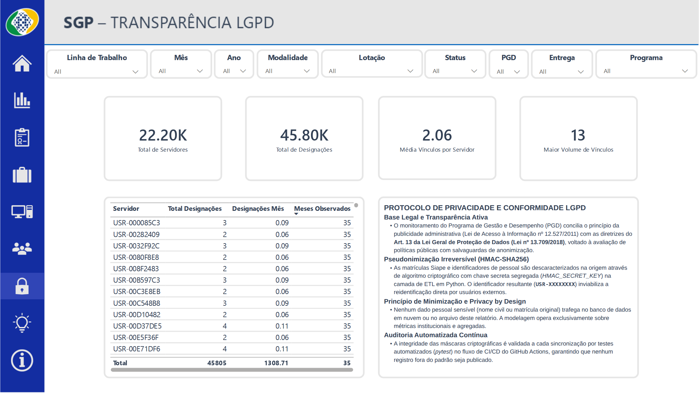

# Insights Executivos do Dashboard - Acompanhamento PGD / INSS

> **Relatório Analítico Gerado Automaticamente por Inteligência Artificial (Google Gemini - gemini-3.6-flash)**  
> **Última Atualização:** 16/11/2026 às 19:22  
> *Diagnóstico executivo sintetizado de forma autônoma a partir dos microdados oficiais tratados do PGD/INSS.*

---

> **Nota Metodológica & Governança**
> Este relatório executivo foi consolidado a partir do processamento da base histórica em formato Apache Parquet, cobrindo o período de outubro de 2023 a agosto de 2026 (35 competências). Para assegurar o cumprimento rigoroso da Lei Geral de Proteção de Dados Pessoais (Lei Federal nº 13.709/2018), os identificadores individuais dos servidores foram submetidos à pseudonimização determinística via algoritmo de hash criptográfico HMAC-SHA256. As análises aqui expostas visam subsidiar a tomada de decisão estratégica da Alta Direção do Instituto Nacional do Seguro Social (INSS), fundamentando-se em métricas consolidadas de produtividade, adesão e conformidade regulatória do Programa de Gestão e Desempenho (PGD).

---

## Resumo Rápido da Série Histórica

A análise da série temporal de 35 meses revela a consolidação do Programa de Gestão e Desempenho no âmbito do INSS como um instrumento maduro de governança da força de trabalho. 

- **Universo de Servidores Acompanhados:** 22.200 servidores registraram atuação vinculada ao PGD no período acumulado.
- **Volume Total de Actos de Designação:** 652.788 pactuações formalizadas, resultando em uma média mensal de 18.651 designações.
- **Portfólio de Programas:** 26 programas de gestão ativos parametrizados no sistema.
- **Densidade de Vínculos:** Média de 2,06 vínculos por servidor ao longo da série histórica, com um teto máximo identificado de 12 designações concorrentes/sucessivas.

---

## Destaques da Última Competência (08/2026 vs. 07/2026)

O comparativo entre a competência corrente (08/2026) e a imediatamente anterior (07/2026) indica estabilidade na adesão global ao PGD, acompanhada por um avanço marginal no teletrabalho e pela ausência de desligamentos no período.

- **Servidores Designados (Plano Ativo):** Expansão de **+0,23%**, subindo de 17.545 para **17.585** servidores pactuados.
- **Servidores Não Designados:** Elevação de **+0,50%**, passando de 4.592 para **4.615** servidores no quadro não participante ou temporariamente sem plano ativo.
- **Desligamentos no Mês:** Redução de **-100,00%** (de 42 desligamentos no mês de 07/2026 para **0** ocorrências em 08/2026), refletindo estabilização dos fluxos operacionais de cancelamento.
- **Distribuição Teletrabalho vs. Presencial:** O regime de teletrabalho (somatório das modalidades remota e semipresencial) registrou **9.311 servidores** (52,9% do efetivo pactuado), apresentando variação positiva de **+0,62% MoM**. O regime exclusivamente presencial absorve **8.274 servidores** (47,1% da força pactuada).

---

## Análise Detalhada dos 6 Eixos do Painel

### Eixo 1: Visão Geral de Adesão e Efetivo Acompanhado

A sustentação de 17.585 servidores com planos ativos demonstra a consolidação institucional do PGD. A razão entre servidores designados (17.585) e não designados (4.615) aponta para uma taxa de cobertura direta do programa superior a 79% da força de trabalho total monitorada na base. A variação MoM de +0,23% no volume de designados demonstra uma dinâmica de maturidade e equilíbrio operacional, sem oscilações bruscas de ingresso ou saída.

---

### Eixo 2: Distribuição por Modalidades de Trabalho

A distribuição das pactuações por modalidade reflete o equilíbrio entre o atendimento presencial nas agências e o processamento remoto de demandas do fluxo de benefícios.

| Modalidade | Designações no Mês | Proporção no Mês |
| :--- | :---: | :---: |
| **Presencial** | 8.286 | 47.1% |
| **Remoto** | 8.067 | 45.8% |
| **Semipresencial** | 1.245 | 7.1% |

O teletrabalho (Remoto + Semipresencial) representa a maioria das pactuações vigentes (52,9%). O modelo semipresencial (7,1%) atua como camada intermediária para setores que exigem flexibilidade operacional sem o desligamento físico completo da unidade.

---

### Eixo 3: Ciclo de Vida e Duração dos Programas de Gestão

A análise da duração média dos programas revela dois perfis de gestão nítidos dentro do INSS: programas voltados à governança e controle (com vigências longas e continuadas) e programas operacionais orientados a ciclos periódicos.

| Sigla do Programa | Duração Média (Dias) | Perfil de Gestão |
| :--- | :---: | :--- |
| **PG-ACS** | **1101 dias** | Governança / Controle / Estratégico |
| **PG-DTI** | **911 dias** | Governança / Controle / Estratégico |
| **CES1** | **887 dias** | Governança / Controle / Estratégico |
| **ATEND_ACGREVE** | **870 dias** | Governança / Controle / Estratégico |
| **DIR_CENTRAL1** | **729 dias** | Operacional / Ciclos Periódicos |
| **CEAB1** | **706 dias** | Operacional / Ciclos Periódicos |

Programas como o PG-ACS (1.101 dias) e PG-DTI (911 dias) caracterizam-se por horizontes temporais estendidos, adequados a atividades contínuas de governança e tecnologia. Em contrapartida, estruturas operacionais como CEAB1 (706 dias) mantêm renovações mais frequentes ajustadas às metas de produção de análise de benefícios.

---

### Eixo 4: Concentração Operacional por Programa

A alocação de pessoal demonstra forte concentração nos programas focados na análise centralizada de direitos e na rede de atendimento.

| Programa | Volume |
| :--- | :---: |
| **PROGRAMA DA CEAB I** | 6.777 servidores |
| **PROGRAMA DAS SUPERINTENDÊNCIAS - PGD** | 4.573 servidores |
| **PROGRAMA DAS UNIDADES DE ATENDIMENTO - PT 1800** | 3.079 servidores |
| **PROG. PRESENCIAL 6H + PONTUAÇÃO** | 1.976 servidores |
| **PROGRAMA DAS ÁREAS DA DIREÇÃO CENTRAL** | 995 servidores |

O **PROGRAMA DA CEAB I** lidera isoladamente com 6.777 servidores, evidenciando o direcionamento maciço da força de trabalho para o enfrentamento do estoque de processos de reconhecimento de direitos. 

---

### Eixo 5: Alocação Estratégica por Lotações e Unidades

A distribuição por lotações destaca as unidades administrativas e finalísticas com maior densidade de pactuações vigentes.

| Lotação | Volume |
| :--- | :---: |
| **COORDENACAO DE GESTAO DE ORCAMENTO, FINANCAS E LOGISTICA** | 749 servidores |
| **COORDENACAO DE GESTAO DE PESSOAS** | 747 servidores |
| **SECAO DE ANALISE DE RECONHECIMENTO DE DIREITOS** | 656 servidores |
| **SECAO DE ATENDIMENTO DE DEMANDAS JUDICIAIS** | 607 servidores |
| **SERVICO DE GERENCIAMENTO DE BENEFICIOS** | 552 servidores |

As Coordenações de Orçamento/Logística (749) e Gestão de Pessoas (747) lideram a alocação de recursos corporativos, seguidas de perto pelas seções finalísticas de Análise de Direitos (656) e Demandas Judiciais (607).

---

### Eixo 6: Foco Produtivo por Linhas de Trabalho

O detalhamento por linhas de trabalho ratifica a relevância estratégica das Regiões Nordeste e Sudeste I na vazão operacional do Instituto.

| Linha de Trabalho | Volume |
| :--- | :---: |
| **Linha de Trabalho - Unidades de Atendimento SRNE** | 1.873 servidores |
| **Central de Análise de Benefícios de Reconhecimento de Direitos SRNE** | 1.695 servidores |
| **Superintendência Regional Nordeste** | 1.640 servidores |
| **Linha de Trabalho - Unidades de Atendimento SRSE1** | 1.390 servidores |
| **Central de Análise de Benefícios de Reconhecimento de Direitos SRSE1** | 1.173 servidores |

A Superintendência Regional Nordeste (SRNE) agrega a maior concentração de servidores pactuados em linhas de trabalho tanto no atendimento presencial quanto nas centrais de análise, somando mais de 5,2 mil alocações diretas nas suas frentes operacionais.

---

## Auditoria de Vínculos & Conformidade LGPD

Em conformidade com as diretrizes de transparência passiva e governança de dados, o monitoramento contínuo auditou o histórico de multiplicidade de vínculos. A média institucional é de 2,06 designações por servidor. Abaixo, destacam-se os casos de maior intensidade de repactuação ou concorrência acumulada na série histórica, preservados sob codificação HMAC-SHA256:

| Servidor (Código LGPD) | Total Designações | Designações / Mês | Meses Observados |
| :---: | :---: | :---: | :---: |
| `USR-AAD51E3A` | **12** | 0.35 | 34 |
| `USR-FFB5C436` | **12** | 0.36 | 33 |
| `USR-79379680` | **10** | 0.29 | 35 |
| `USR-DDAE3965` | **9** | 0.26 | 34 |
| `USR-360E60E9` | **9** | 0.26 | 35 |
| `USR-EE5D9946` | **9** | 0.28 | 32 |
| `USR-A81A7AAA` | **9** | 0.28 | 32 |
| `USR-27D83F6D` | **8** | 0.23 | 35 |

A análise dos dados indica que as múltiplas pactuações decorrem de renovações periódicas ao longo dos 35 meses de histórico ou de transições funcionais entre programas, permanecendo a taxa de designações por mês dentro de parâmetros aceitáveis (0,23 a 0,36 designações/mês).

---

## Recomendações Executivas para o Próximo Ciclo

1. **Instituir Trava de Segurança e Alerta Automático para Múltiplas Pactuações:**
   Embora a taxa média institucional seja de 2,06 vínculos por servidor, recomenda-se a implementação de alertas de governança no sistema para servidores que atingirem mais de 8 designações acumuladas ou simultâneas, prevenindo sobreposição de planos de trabalho e garantindo a rastreabilidade das entregas.

2. **Reequilíbrio de Carga Operacional Entre Regiões:**
   Diante da elevada concentração de força de trabalho nas linhas de trabalho da SRNE (SRNE Unidades: 1.873; CEAB SRNE: 1.695) e SRSE1 (SRSE1 Unidades: 1.390; CEAB SRSE1: 1.173), recomenda-se a avaliação de redistribuição temporária de cotas de teletrabalho para regiões com maior represamento de processos e menor contingente alocado.

3. **Padronização dos Ciclos de Vida de Programas Operacionais:**
   Considerando a disparidade identificada no Eixo 3 entre programas de governança (ex: PG-ACS com 1.101 dias) e programas operacionais (ex: CEAB1 com 706 dias), sugere-se a normatização dos prazos de repactuação dos programas finalísticos para ciclos de 365 dias, alinhando a avaliação de desempenho ao ciclo orçamentário e às metas institucionais anuais.