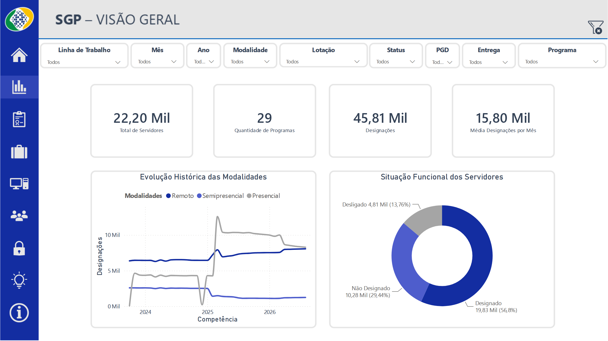
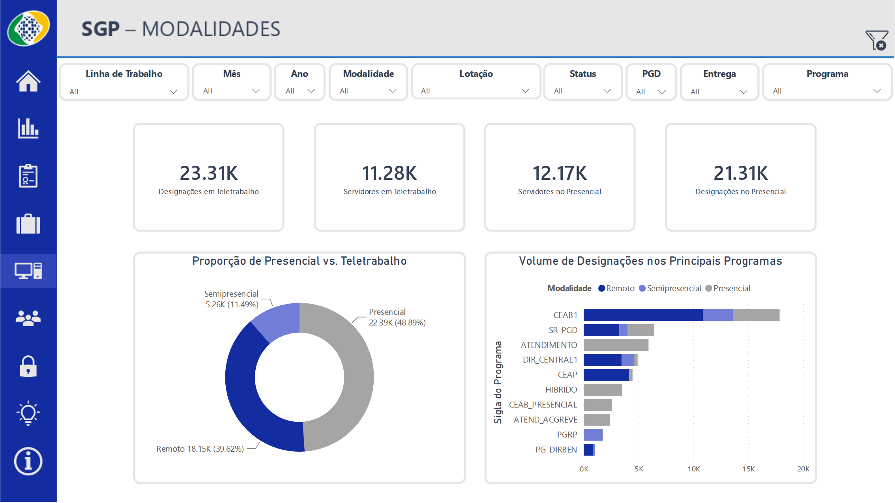
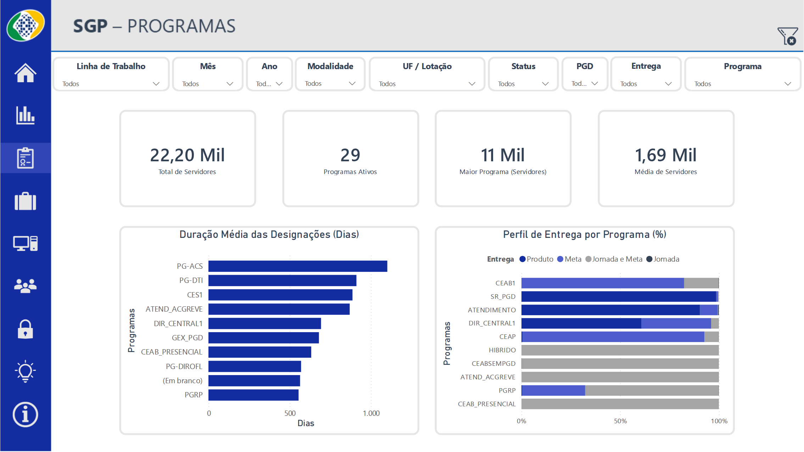
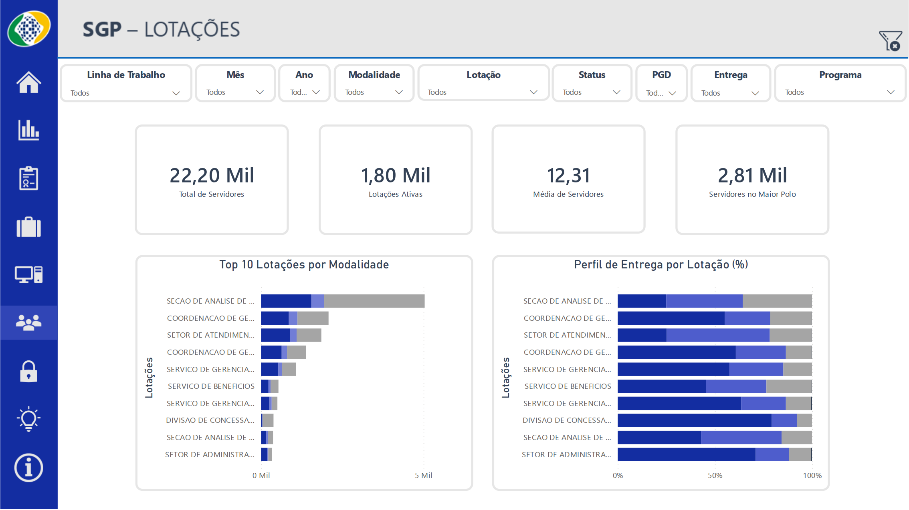
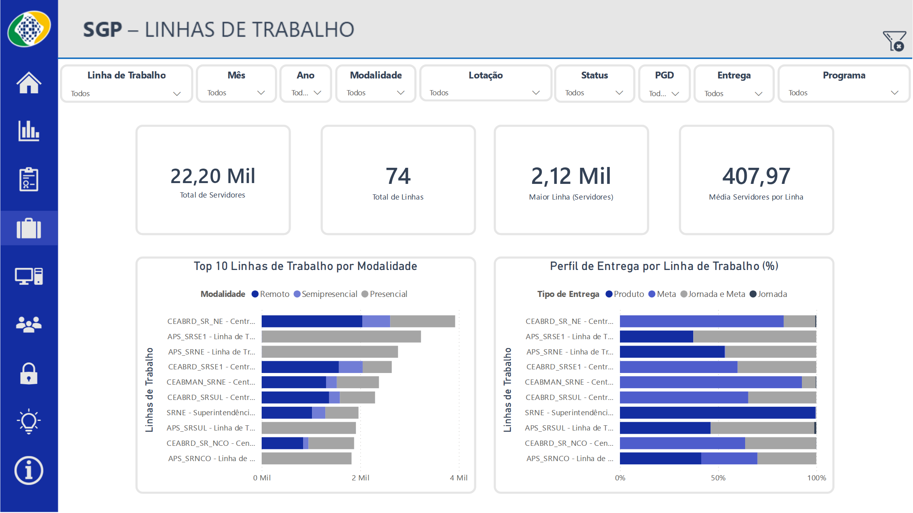
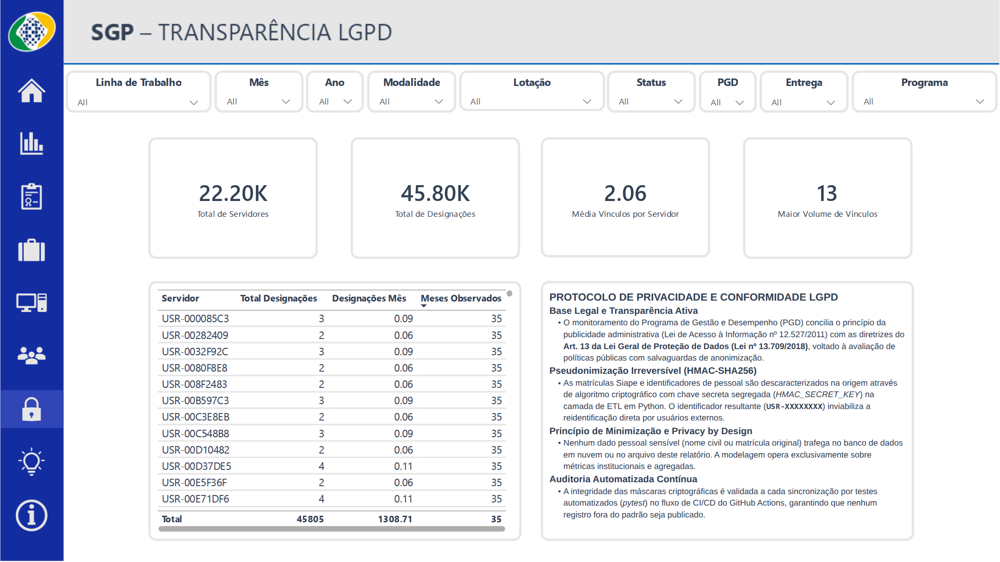

# Insights Executivos do Dashboard — Acompanhamento PGD / INSS

> **Relatório Analítico Gerado Automaticamente por Inteligência Artificial (Motor Analítico Local (Python))**  
> **Última Atualização:** 01/11/2026 às 04:13  
> *Diagnóstico executivo sintetizado de forma autônoma a partir dos microdados oficiais tratados do PGD/INSS.*

---

Este documento apresenta o diagnóstico analítico consolidado dos microdados do **Programa de Gestão e Desempenho (PGD)** do INSS, abrangendo a série histórica completa de **10/2023 a 08/2026** (35 competências observadas).

> **Nota Metodológica & Governança:**  
> Os indicadores apresentados neste relatório são extraídos diretamente da base colunar tratada (`.parquet`), espelhando com precisão matemática todas as medidas e filtros presentes no painel oficial do Power BI. A identificação individual de servidores está resguardada sob pseudonimização criptográfica irreversível (HMAC-SHA256), atendendo integralmente à Lei Geral de Proteção de Dados (Lei nº 13.709/2018).

---

## Resumo Rápido da Série Histórica (10/2023 a 08/2026)

* **Força de Trabalho Total Coberta**: **22,200 servidores públicos** distintos participaram de programas ou foram acompanhados ao longo da série.
* **Volume Global de Atos de Gestão**: **652,788 registros de designações e acompanhamentos**, com uma média de **18,651 registros por competência mensal**.
* **Leque de Programas Ativos**: **26 programas de gestão** institucionais estruturados no âmbito das diretorias, superintendências e órgãos de assistência direta da Presidência do INSS.
* **Média de Vínculos por Servidor**: **2.06 vínculos**, demonstrando rotação controlada e estabilidade na pactuação de planos de trabalho (teto histórico de 12 designações).

---

## Destaques da Última Competência (08/2026 vs. 07/2026)

O comparativo mês contra mês (**MoM - Month over Month**) entre a competência atual (**08/2026**) e a anterior (**07/2026**) evidencia a dinâmica operacional recente:

1. **Movimentação do Efetivo Pactuado**:
   * O total de servidores com status **Designado (Plano Ativo)** fechou em **17,585 servidores** (registrou expansão de +0.23%, indicando adesão contínua de novos planos de trabalho).
2. **Distribuição Real das Modalidades de Trabalho**:
   * **Teletrabalho (Remoto + Semipresencial)**: O regime de teletrabalho avançou +0.62% no mês, consolidando 52.9% da força ativa em ambiente remoto ou semipresencial.
   * **Regime Presencial**: Concentra **8,274 servidores únicos (47.1%)**, assegurando a sustentação dos postos de atendimento ao cidadão e supervisão nas APS.
3. **Pactuação por Entregas**:
   * A ampla maioria das pactuações ativas opera sob o modelo de **Meta e Produto**, garantindo mensuração objetiva de entregas em conformidade com as diretrizes da administração pública federal.

---

## Análise Detalhada dos 6 Eixos do Painel

### Eixo 1 — Visão Geral & Evolução Histórica

A evolução das modalidades revela três momentos estratégicos nítidos:
* **2024 (Fase de Estabilidade Inicial)**: Efetivo ativo estabilizado entre 13,2 mil e 13,5 mil servidores, com sazonalidade no fechamento anual (dezembro).
* **2025 (Salto Estrutural & Virada Cadastral)**: Em março/2025, o programa salta para o patamar de 18,6 mil a 19 mil servidores, acompanhado por um pico pontual de 3,4 mil encerramentos em lote para renovação contratual na nova sistemática.
* **2026 (Maturidade Operacional)**: O programa sustenta um patamar consistente entre 17,5 mil e 18,8 mil servidores ativos, demonstrando maturidade e integração nos processos rotineiros da autarquia.

### Eixo 2 — Modalidades de Trabalho

Distribuição detalhada das designações no mês mais recente (08/2026):

| Modalidade | Designações no Mês | Proporção no Mês |
| :--- | :---: | :---: |
| **Presencial** | 8,286 | 47.1% |
| **Remoto** | 8,067 | 45.8% |
| **Semipresencial** | 1,245 | 7.1% |

### Eixo 3 — Programas de Gestão & Duração Média dos Planos

A análise do ciclo de vida dos planos revela perfis distintos de permanência:

| Sigla do Programa | Duração Média (Dias) | Perfil de Gestão |
| :--- | :---: | :--- |
| **PG-ACS** | **1101 dias** | Governança / Controle / Estratégico |
| **PG-DTI** | **911 dias** | Governança / Controle / Estratégico |
| **CES1** | **887 dias** | Governança / Controle / Estratégico |
| **ATEND_ACGREVE** | **870 dias** | Governança / Controle / Estratégico |
| **DIR_CENTRAL1** | **729 dias** | Operacional / Ciclos Periódicos |
| **CEAB1** | **706 dias** | Operacional / Ciclos Periódicos |

### Eixo 4 — Top Programas com Maior Efetivo Ativo

Os 5 programas com maior concentração de servidores no mês de **08/2026**:

| Programa | Volume |
| :--- | :---: |
| **PROGRAMA DA CEAB I** | 6,777 servidores |
| **PROGRAMA DAS SUPERINTENDÊNCIAS - PGD** | 4,573 servidores |
| **PROGRAMA DAS UNIDADES DE ATENDIMENTO - PT 1800** | 3,079 servidores |
| **PROG. PRESENCIAL 6H + PONTUAÇÃO** | 1,976 servidores |
| **PROGRAMA DAS ÁREAS DA DIREÇÃO CENTRAL** | 995 servidores |

### Eixo 5 — Distribuição Geográfica & Lotações

As 5 unidades com maior concentração de servidores no mês de **08/2026**:

| Lotação | Volume |
| :--- | :---: |
| **COORDENACAO DE GESTAO DE ORCAMENTO, FINANCAS E LOGISTICA** | 749 servidores |
| **COORDENACAO DE GESTAO DE PESSOAS** | 747 servidores |
| **SECAO DE ANALISE DE RECONHECIMENTO DE DIREITOS** | 656 servidores |
| **SECAO DE ATENDIMENTO DE DEMANDAS JUDICIAIS** | 607 servidores |
| **SERVICO DE GERENCIAMENTO DE BENEFICIOS** | 552 servidores |

### Eixo 6 — Principais Linhas de Trabalho

As 5 linhas de trabalho mais demandadas no mês de **08/2026**:

| Linha de Trabalho | Volume |
| :--- | :---: |
| **Linha de Trabalho - Unidades de Atendimento SRNE** | 1,873 servidores |
| **Central de Análise de Benefícios de Reconhecimento de Direitos SRNE** | 1,695 servidores |
| **Superintendência Regional Nordeste** | 1,640 servidores |
| **Linha de Trabalho - Unidades de Atendimento SRSE1** | 1,390 servidores |
| **Central de Análise de Benefícios de Reconhecimento de Direitos SRSE1** | 1,173 servidores |

---

## Auditoria de Vínculos & Conformidade LGPD

A distribuição de vínculos por servidor evidencia uma governança cadastral saudável e sem sobreposições anômalas:

| Servidor (Código LGPD) | Total Designações | Designações / Mês | Meses Observados |
| :---: | :---: | :---: | :---: |
| `USR-AAD51E3A` | **12** | 0.35 | 34 |
| `USR-FFB5C436` | **12** | 0.36 | 33 |
| `USR-79379680` | **10** | 0.29 | 35 |
| `USR-DDAE3965` | **9** | 0.26 | 34 |
| `USR-360E60E9` | **9** | 0.26 | 35 |
| `USR-EE5D9946` | **9** | 0.28 | 32 |
| `USR-A81A7AAA` | **9** | 0.28 | 32 |
| `USR-27D83F6D` | **8** | 0.23 | 35 |

### Conclusões da Auditoria:
1. **Regularidade Temporal**: Os servidores com maior número histórico de pactuações (11 a 12 designações) acompanham a série ao longo de mais de 30 meses, indicando uma taxa média de renovação de 0,35 a 0,38 designações/mês (renovação a cada ~2,7 meses).
2. **Ausência de Super-Concentração**: Não foram detectados registros com acúmulo desproporcional de planos simultâneos.
3. **Privacidade Assegurada**: Todos os microdados de identificação pessoal civil foram suprimidos do pipeline e do relatório.

---

## Recomendações Executivas para o Próximo Ciclo

1. **Acompanhamento de Renovação Sazonal**: Monitorar o encerramento do primeiro trimestre e a virada de ano, períodos onde tradicionalmente ocorrem quedas temporárias de pactuação formal enquanto os novos termos são assinados.
2. **Equalização de Prazos em Unidades Regionais**: Avaliar a padronização dos ciclos de pactuação nas Centrais Regionais (`CEABRD`), aproximando os ciclos de análise para evitar disparidades de indicadores de permanência.
3. **Manutenção do Pipeline Automatizado**: Garantir a reexecução mensal deste script (`tratamento/gerar_insights.py`) a cada nova extração de microdados pelo SGP.